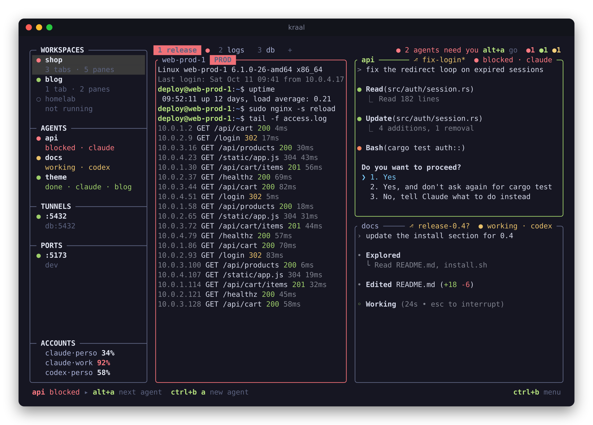
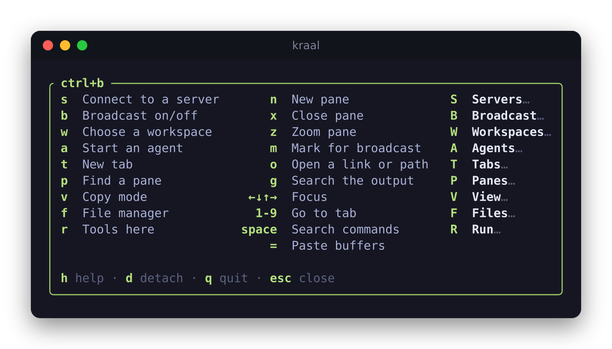

<h1 align="center">kraal</h1>

<p align="center">
  <b>A terminal multiplexer that knows your servers and your coding agents.</b>
</p>

<p align="center">
  <a href="#install">Install</a> ·
  <a href="#quick-start">Quick start</a> ·
  <a href="docs/README.md">Docs</a> ·
  <a href="https://github.com/kraal-sh/kraal/releases">Releases</a>
</p>

<p align="center">
  <a href="https://github.com/kraal-sh/kraal/actions/workflows/ci.yml"></a>
  <a href="https://github.com/kraal-sh/kraal/releases/latest"></a>
  <a href="https://crates.io/crates/kraal"></a>
  <a href="LICENSE"></a>
</p>

<p align="center">
  
</p>

kraal runs in the terminal you already use: panes, tabs and workspaces that keep running when you
close the window. It also knows what each pane is doing: the server it is
on, the branch, whether that server is production, the agent working there and whether it is
waiting for you.

- **Never hunt for the stuck agent.** Claude Code, Codex, OpenCode, Gemini and 26 others are
  marked working, blocked or done, in the sidebar and on their pane, with a desktop notification.
  Those running in kraal on your servers are listed too. `alt+a` jumps to the next one that needs
  you.
- **Several agents on one repository.** Start an agent in its own worktree and branch, then
  review, commit, open a pull request or merge without leaving kraal.
- **Every subscription you pay for.** A personal and a work Claude plan, two Codex plans: kraal
  shows each one's usage, picks one per project, and moves to another when one reaches its
  limit.
- **Your servers, one key away.** kraal remembers every host you ssh to. Open one, or a whole
  group in a grid; type in all of them at once; copy files between any two; keep tunnels open.
- **Production looks like production.** A pane on a production server, cluster, Terraform
  workspace or AWS profile gets a red frame, and kraal asks before broadcast typing or a
  multi-line paste lands there.
- **Tools where you are.** lazygit, k9s, htop or the logs open on the focused pane's server or in
  its directory. `ctrl+b o` labels every link, path, commit or pod on screen, to copy or open it.
- **Runbooks that stop at the first failure.** Procedures kept as files run server by server
  after showing their plan, and log everything. Your Markdown docs run block by block.
- **Close the terminal, keep working.** Sessions keep running when the window closes or the
  connection drops. After a reboot, kraal rebuilds the layout with each pane's scrollback,
  reconnects SSH shells and resumes agent conversations.
- **One binary, any modern terminal.** Linux and macOS. The kitty keyboard protocol (Shift+Enter
  reaches Claude Code), images in panes (kitty graphics and sixel), shell integration, the mouse.

## Install

```sh
curl -fsSL https://raw.githubusercontent.com/kraal-sh/kraal/main/install.sh | sh
```

Or, with Rust 1.88 or later:

```sh
cargo install kraal
```

The script takes the [prebuilt archive](https://github.com/kraal-sh/kraal/releases) for your
machine (Linux and macOS, x86_64 and arm64), checks its checksum and installs into
`~/.local/bin`. To update later, `kraal update` for the script's install, `cargo install kraal`
again for Cargo's. [More ways](docs/install.md)

## Quick start

```sh
kraal                              # start a session, or attach to the running one
kraal integration install claude   # exact agent states from Claude Code's hooks (gemini, copilot, opencode… too)
```

Press `ctrl+b` and let go: a menu shows what each next key does. `ctrl+b d` detaches, and
`kraal` brings you back where you were.

## Keys you can guess



After `ctrl+b`, a theme's letter runs its main action and the capital opens its menu: `s`
connects to a server, `S` shows everything about servers. The same letters mean the same thing in
every menu (`n` new, `x` close, `e` rename). Shortcuts work on any keyboard layout, and every command
and every menu can move to the keys you want.
[Keys](docs/keys.md)

## Workspaces as files

Declare a workspace once and open it in one command (`kraal shop`): tabs, splits, stacks, servers,
commands, agents and live previews, in a KDL file.

```kdl
layout {
    cwd "~/src/shop"
    tab name="release" {
        pane split_direction="vertical" {
            pane command="ssh" { args "deploy@web-prod-1"; }
            pane split_direction="horizontal" {
                pane agent="claude"              // a shell that starts claude
                pane preview="CHANGELOG.md"      // a live Markdown preview
            }
        }
    }
}
```

[Sessions and workspaces](docs/workspaces.md)

## Made to be scripted

Every pane knows its session, so scripts and agents drive kraal from inside it:

```sh
kraal run --right --name tests -- cargo test     # a new pane; prints its id
kraal wait -p api --until blocked,done           # until the agent in "api" needs you
kraal exec @prod -- uptime                       # on every server of a group, in parallel
kraal events agent.blocked pane.failed           # what happens, as JSON lines
```

`[hooks]` runs a command on any event: ping your phone when an agent is blocked, log every SSH
connection to production. [Scripting, events and hooks](docs/scripting.md)

## Documentation

[Install](docs/install.md) ·
[Keys](docs/keys.md) ·
[Sessions and workspaces](docs/workspaces.md) ·
[Servers](docs/servers.md) ·
[Coding agents](docs/agents.md) ·
[Tools, contexts and hints](docs/tools.md) ·
[Production](docs/production.md) ·
[Runbooks](docs/runbooks.md) ·
[Shell integration and images](docs/terminal.md) ·
[Scripting, events and hooks](docs/scripting.md) ·
[Configuration](docs/configuration.md)

## The name

A kraal is an enclosure for cattle, in southern Africa. Servers are cattle, not pets, and now
agents are too.

## Status

kraal is young. Linux is used every day; macOS passes the whole test suite on every release but
nobody uses it daily yet; Windows is not supported. Known gaps:

- Images in panes and previews need a terminal that draws kitty graphics with Unicode
  placeholders (Ghostty, kitty) or sixel (foot, WezTerm, Konsole, Windows Terminal…); elsewhere
  their cells stay blank, and previews use half blocks. Over sixel, an image that output scrolls
  shows again once it stays put, and never on the window's last row.
- Agent states come from hooks for Claude Code and eight other agents, and for what Gemini CLI's,
  Codex's, Cursor's and Augment's hooks tell; otherwise they are read from the screen and can lag.

Bug reports and ideas are welcome in the [issues](https://github.com/kraal-sh/kraal/issues).

## Development

```sh
cargo test        # unit and end-to-end tests
```

## License

Copyright 2026 vodhash and the kraal contributors.

Licensed under the [Apache License, Version 2.0](LICENSE).

Unless you explicitly state otherwise, any contribution intentionally submitted for inclusion in
kraal by you, as defined in the Apache-2.0 license, shall be licensed as above, without any
additional terms or conditions.
